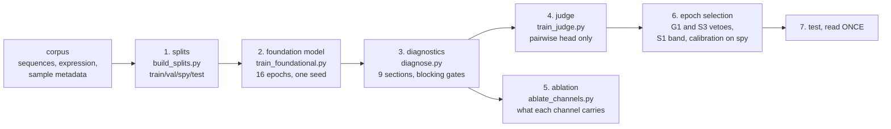

# HYperbolicPromoterProgrammingEngine

A foundation model of fungal promoters: 800 bp of sequence encoded into a
five-level hyperbolic cone ladder of discrete codes, read by heads that
predict expression strength, rank two promoters against each other, and tell a
promoter from a composition-matched negative.

## Overview

HYPPE is trained on promoters of *Trichoderma atroviride* and nineteen related
strains, against expression measured across public RNA-seq studies. A promoter
enters as one-hot ACGT; it leaves as five levels of quantised codes, coarse to
fine, composed along geodesics on a hyperboloid. Every level is a length
scale, one L0 cell spans 32 bp, one L4 cell spans 2 bp, so an ablation is a
statement about a scale rather than about an anonymous channel.

The repository contains the model, its training, the split, the diagnostics
and the epoch-selection protocol. It does **not** contain the design pipeline
that turns the trained model into candidate sequences; that is a separate
concern and is documented separately.

The software was developed as an iGEM software project. Nothing in the method
is specific to fungi, but see [Known limitations](#known-limitations) before
assuming it transfers.

[**docs/model.md**](docs/model.md) explains the model in full, the geometry
and the losses with their mathematics, figures of the architecture and of the
code ladder, and how the ten synthetic promoters sent to the wet lab were
chosen. Read that for the method; read this file to run it.
[**docs/ablations.md**](docs/ablations.md) is the baseline comparison that
justifies the architecture, including the parts of it that are less
flattering than we expected, and the measured carbon cost of training.

> Expression is predicted from RNA-seq data. The model has not been validated
> in the laboratory, and a predicted strength is not a prediction of measured
> promoter activity. Three domain shifts separate the training label from a
> wet read-out: mRNA to protein, native locus to plasmid, and rank within a
> library to one absolute value.

## What is in this repository

| you want | go to |
|---|---|
| the model explained, with figures and the maths | [docs/model.md](docs/model.md), or [the same document in Word](docs/HYperbolic_Promoter_Programming_Engine.docx) |
| the same document for a viewer that will not render Word equations | [the PDF](docs/HYperbolic_Promoter_Programming_Engine.docx.pdf) |
| why this architecture and not a simpler one | [docs/ablations.md](docs/ablations.md) |
| **what we built wrong, and how we found out** | [docs/model.md §9](docs/model.md) |
| what the model is looking at, on the ten designs | [notebooks/xai_final_model.ipynb](notebooks/xai_final_model.ipynb) |
| the configuration the delivered model was trained with | [config/default.yaml](config/default.yaml) |
| per-epoch metrics as CSV, for plotting | [results/training_report/](results/training_report/) |
| how condition metadata is curated | [docs/conditions.md](docs/conditions.md) |
| the energy and carbon cost of training | [docs/ablations.md](docs/ablations.md#carbon-cost-of-training-the-final-architecture) |
| to run something | [Usage](#usage) below |

**The trained weights ship with the repository**, in `weights/`, together
with everything needed to build the model around them:

```
weights/hyppe_foundational.pt    52 MB  the foundation model
weights/hyppe_judge.pt           18 MB  the fine-tuned ranking head
data/motifs.meme                        252 frozen PWM profiles
data/trees/external/*.tre               the 20-leaf phylogeny
data/conditions/condition_taxonomy.tsv  the category vocabulary
data/category_text_emb.npz              the category prototypes
data/final_datasets/orthology/*.tsv     the gene channel's features
data/splits/splits.tsv                  the production split
data/final_promoters.*                  the ten designs and two anchors
```

## Contents

- [Motivation](#motivation)
- [Background](#background)
- [Workflow](#workflow)
- [Installation](#installation)
- [Usage](#usage)
- [Configuring a run](#configuring-a-run)
- [Outputs](#outputs)
- [Interpretation](#interpretation)
- [Validation](#validation)
- [Known limitations](#known-limitations)
- [Repository layout](#repository-layout)
- [References](#references)
- [License](#license)

## Motivation

Predicting how strongly a promoter drives transcription is a sequence-to-scalar
problem with three awkward properties. The label is noisy and comes from
studies that are not comparable with one another. The examples are not
independent: orthologues of one gene share most of their sequence, so a
random split reports a number that will not survive on new loci. And a model
whose latent is a dense vector can be accurate while saying nothing about
*which part* of a promoter carries its strength.

This model answers the third by quantising the sequence into a hierarchy of
discrete codes and forbidding the decoder any other input, so that whatever
the latent fails to carry is visibly lost. It answers the second by splitting
on homology clusters rather than rows. The first it does not solve; it reports
the spread it measures and keeps a held-out split closed until the end.

## Background

**Hyperbolic geometry, and the honest reason for it.** Hyperbolic space
embeds trees with low distortion ([Nickel and Kiela 2018](https://arxiv.org/abs/1806.03417)),
and the usual argument for using it is that the data are hierarchical. On
these data that argument does not hold: the Gromov δ of regulatory sequence
is not meaningfully lower than that of random points. What *is* a tree by
construction is the codebook hierarchy itself, a coarse code and the
refinements under it, and that is the only justification claimed here.

**The ladder.** Level 0 quantises a *position*: a point on the hyperboloid,
chosen from a codebook of 128 by geodesic distance. Levels 1–4 quantise a
*refinement*: a tangent vector on a finite scalar grid
([Mentzer et al. 2024](https://arxiv.org/abs/2309.15505)), composed onto the
parent along a geodesic,

```
p_{k+1} = expmap(p_k, PT(origin -> p_k, v_{k+1}) + s_k * radial(p_k))
```

where `PT` is parallel transport and the radial term pushes each level onto a
shell of larger radius. Without that term the radius random-walks and the
levels collapse onto one shell. The grid of every refinement level contains
exactly zero, so **every prefix of the ladder is itself a legal code**, which
is what makes a coarse-only reconstruction a meaningful quantity rather than a
broken one. The codebook is maintained by a geodesic EMA with dead-code
restart, in the manner of VQ-VAE ([van den Oord et al. 2017](https://arxiv.org/abs/1711.00937))
but with the Fréchet mean in place of the arithmetic one.

| level | cells | bp per cell | alphabet | bits/position | bits |
|---|---|---|---|---|---|
| L0 | 25 | 32 | 128 | 7.0000 | 175.0 |
| L1 | 50 | 16 | 729 | 9.5098 | 475.5 |
| L2 | 100 | 8 | 81 | 6.3399 | 634.0 |
| L3 | 200 | 4 | 9 | 3.1699 | 634.0 |
| L4 | 400 | 2 | 9 | 3.1699 | 1268.0 |
| | | | | **total** | **3186.5** |

Against 1598.7 bits of sequence (800 bp at a measured 1.9983 bits/bp) that is
**1.99× headroom**. This has to be reported together with the reconstruction
quality and never apart from it: at twice the budget the latent *describes* the
promoter rather than abstracting it. The right word for the result is
**auditable**, not "interpretable".

**Strength regression.** The absolute head predicts a mean, the variance of
its own error, and separately the measured replicate spread, under the β-NLL
objective of [Seitzer et al. 2022](https://arxiv.org/abs/2203.09168) at
β = 0.5. A plain Gaussian likelihood diverged within three epochs: lowering σ
on easy rows raises the relative weight of hard ones, whose σ must then grow,
which lowers the easy ones further. The two sigmas are deliberately not tied, 
fusing them would make the loss weight a function of a label.

**Ranking.** The siamese head learns on the difference of two scores under a
Bradley–Terry likelihood ([Bradley and Terry 1952](https://doi.org/10.2307/2334029)).
There is no margin, and that is a deletion rather than a default: a hinge has
exactly zero gradient once a pair is ordered past its threshold, so it stops
learning while still wrong about the *size* of the gap, and the size of the
gap is what a correlation metric reads. Pairs are drawn inside one
(genome, category) cell, because the question "which of these is stronger" is
only defined when the condition is shared.

**Negatives.** The discriminator separates real promoters from
composition-matched negatives: dinucleotide-preserving shuffles, and chimeras
spliced from two promoters of the same genome. The shuffle is the head's own
falsifier; it preserves composition, so a discriminator that beat it on GC
alone would have learned nothing, and the configuration refuses to build the
head without it.

**Balancing the tasks.** Three heads share one encoder. Their gradients over
that shared scope are rescaled to unit norm, multiplied by an explicit prior
and renormalised. Reconstruction is deliberately *not* a fourth player but a
constraint with a Lagrange multiplier ([Rezende and Viola 2018](https://arxiv.org/abs/1810.00597)).
The reason is arithmetic: a bargain equalises utilities, so it hands the
largest weight to the player with the weakest gradient, and a near-solved
task has the weakest gradient. Measured on an earlier run, reconstruction took
2.31 of a budget of 3.0 while the two prediction tasks were suppressed to 0.39
and 0.31.

**Manifold parameters.** Codebook points and strain vectors live on the
hyperboloid and are optimised with a Riemannian Adam
([Bécigneul and Ganea 2019](https://arxiv.org/abs/1810.00760)): the Euclidean
gradient is converted by raising the metric, the step is an exponential map,
and the momentum is parallel-transported to the new point. Ordinary AdamW on
those tensors is refused rather than allowed with a warning.

**Conditioning** enters *behind* the quantiser. The encoder is built with a
context dimension of zero and raises if a context is passed to it, so the code
of a sequence is a function of the sequence alone. The condition reaches the
heads as four tokens: the strain as a point on the hyperboloid fitted to a
439-marker phylogeny, the experiment description as a frozen sentence
embedding ([Wang et al. 2020](https://arxiv.org/abs/2002.10957)), and the two
genomic flanks as frozen DNA-language-model vectors.

## Workflow



1. **Splits** (`build_splits.py`). Four sets grouped by **homology cluster**,
   never by row. The anchors are parameters, not constants.
2. **Foundation model** (`train_foundational.py`). One seed drives data order,
   initialisation and masking. Every epoch may be archived so that a different
   selection rule can be tested without retraining.
3. **Diagnostics** (`diagnose.py`). Nine sections, each with a falsifier.
   Blocking sections exit non-zero; observational ones report a number and do
   not block, because a mechanism nobody measures is a mechanism nobody can
   defend.
4. **Judge** (`train_judge.py`). The pairwise head is fine-tuned on anchor
   pairs alone; a guard asserts that every weight outside `pairwise.*` moved
   by exactly 0.
5. **Ablation** (`ablate_channels.py`). Each conditioning channel is zeroed
   and swapped with another record's value, which are different questions.
6. **Selection**. Two vetoes, then a band, then one tie-break; the rule is
   written down before the numbers are seen.
7. **Test**, once.

## Installation

Developed and tested on Linux; the unit tests and the smoke run also pass on
Windows under WSL.

```bash
git clone <this repository>
```

```bash
cd HYperbolicPromoterProgrammingEngine
```

```bash
conda env create -f environment.yml
```

```bash
conda activate hyppe
```

The environment provides Python 3.11 with torch 2.10, numpy, pandas, scipy,
scikit-learn and biopython, and installs this package in editable mode. The
pinned versions are the ones every number in this repository was produced
with, not lower bounds.

**Check the CUDA build before trusting a training run.** On the cluster used
here a `+cu130` wheel reported `cuda_available=False` against driver 12070,
and pip did not replace it, because the version string is identical:

```bash
python -c "import torch; print(torch.__version__, torch.cuda.is_available())"
```

### Data root

Code and data are separate. The corpus, the expression matrices and the
embedding caches are too large to version, so every path that reads data
honours `HYPPE_DATA_ROOT`, falling back to the repository root:

```bash
export HYPPE_DATA_ROOT=/path/to/hyppe-data
```

Two things *are* versioned here, because a result cannot be interpreted
without them: `data/motifs.meme` (252 frozen profiles) and
`data/splits/splits.tsv` (the production split). Building the model without
the motif bank is refused rather than silently substituted, a model without
it is a different model that would report the same metric names.

## Quickstart: run the model on a sequence

Nothing here needs the training corpus. The weights and the delivered panel
both ship, so a fresh clone can ask the model a question immediately.

```bash
# Score the ten delivered promoters plus both anchors, with the judge.
python scripts/predict.py --judge
```

```
name                             strength     judge
pks1_syn_MAX_gradient             10.7249   12.3608
pks1_syn_MAX_genetic              10.5516   12.1256
pks1_syn_MAX_maskgit              10.4984   12.0753
pks1_syn_MAX_free_diffusion       10.0145   11.4900
pks1_syn_MID_free_diffusion        9.7458   10.6594
tef1                               9.4128   10.6843
pks1_syn_MID_gradient              7.0074    5.6920
pks1_syn_MAX_free_random           6.4264    4.2289
pks1_syn_MID_free_random           6.2714    2.9810
pks1_syn_MID_maskgit               5.1873    0.8271
pks1_syn_MID_genetic               0.8331   -0.3503
pks1                               0.7175   -0.8811
```

Both columns are the model's own scale, not fluorescence, and only the
ordering is meant to carry over to a measurement. The two columns come from
the two shipped checkpoints: `strength` from the foundation model and `judge`
from the fine-tuned ranking head, which is the model that decided panel
membership.

```bash
# Score your own promoters. They must be exactly 800 bp.
python scripts/predict.py --fasta my_promoters.fa --strain P1 --out scores.tsv
```

**What the numbers are not.** The strength column is the model's own scale. It
is not fluorescence, it is not calibrated against any wet-lab read-out, and
only the ordering is meant to transfer — section *Interpretation* below says
why, and the Model documentation in `docs/` lists the three domain shifts
between this number and a measurement. The judge column comes from the second
shipped checkpoint, whose ranking head was fine-tuned on anchor pairs; it is
the model that decides panel membership, and its scale is its own again.

Two more things you can run without a corpus:

```bash
# What is in the pks1 promoter, against the regulators the literature
python scripts/pks1_motifs.py --attention
```

```bash
# The complementary question, asked of the corpus rather than of a motif
python scripts/ism_words.py --n-promoters 200 --k 6
```

```bash
# Interpretability end to end: in-silico mutagenesis, per-level ablation
jupyter notebook notebooks/xai_final_model.ipynb
```

The last of these is the one to read if you only read one. It ends with an
explicit list of what it establishes and what it cannot reach, and the two
headline findings are that the model learned a positional prior nobody gave
it, and that on pks1 the canonical regulator sites are neither enriched nor
used — both with a passing positive control, so they are measurements rather
than silence.

## Usage

```bash
# The acceptance suite on a synthetic corpus: no data, no GPU, ~8 minutes.
bash examples/smoke/run.sh

# Unit tests.
pytest tests -q

# Build a split for your own corpus, from sequences alone.
python scripts/build_splits.py \
    --sequences data/final_datasets/sequences/sequences.tsv.gz \
    --id-column ID --sequence-column SEQUENCE --group-column OG_ID \
    --filter-column GROUP --filter-value Promotor \
    --output data/splits/splits.tsv --split-column H_kmer90 \
    --report data/splits/report.json

# Train the delivered model.
python scripts/train_foundational.py \
    --config config/default.yaml \
    --splits  "$HYPPE_DATA_ROOT/data/splits/SPLIT_V6.tsv" \
    --split-column H_kmer90 \
    --save-every-epoch \
    --out-dir runs/

# What a checkpoint is: its sha256
python scripts/inspect_checkpoint.py runs/hyppe_foundational.pt

# What a fine-tune actually moved.
python scripts/compare_checkpoints.py parent.pt finetuned.pt --expect pairwise

# Falsifier suite on a checkpoint.
python scripts/diagnose.py runs/hyppe_foundational.pt

# Fine-tune the ranking head on anchor pairs.
python scripts/train_judge.py

# What each conditioning channel carries, pooled and per-category.
python scripts/ablate_channels.py weights/hyppe_foundational.pt

# A joint ablation, for channels that are not independent of each other:
TRYBY=baza,bez_text,tas_species,bez_text+tas_species \
    python scripts/ablate_channels.py weights/hyppe_foundational.pt
```

`--gates-only` runs the wiring gates and stops. `--smoke` runs a short
training plus the T1–T5 acceptance tests. Exit codes: `0` all clear, `3` a
wiring gate failed (a method is configured but not reached), `4` an acceptance
falsifier failed.

`--save-every-epoch` is not optional in practice: without it the only
checkpoint is the one the loop's own rule picked, and the selection protocol
below cannot be applied or revisited.

## Reproducing the model and the tree

Three things can be rebuilt from this repository, and they need different
inputs. Read the third column before starting.

| what | needs | roughly |
|---|---|---|
| every number on this page | only what ships | minutes |
| the delivered model | the corpus, through `HYPPE_DATA_ROOT` | ~10 h on one GPU |
| the species tree | public proteomes, plus ours for all 20 strains | hours on a cluster |

### Without the corpus

These run on a fresh clone. Each was checked with `HYPPE_DATA_ROOT` unset,
so the list is what works rather than what ought to.

```bash
bash examples/smoke/run.sh                 # acceptance suite, e.g. 8 min, no GPU
pytest tests -q                            # 85 unit tests
python scripts/predict.py --judge          # score the delivered panel
python scripts/inspect_checkpoint.py weights/hyppe_foundational.pt
python scripts/compare_checkpoints.py \
    weights/hyppe_foundational.pt weights/hyppe_judge.pt --expect pairwise
python scripts/pks1_motifs.py --attention  # the pks1 promoter, with a null
python pipelines/species_tree/check_tree.py \
    data/trees/external/inhouse_nj_20genomes_aasubst.tre --registry
```

Two that look like they belong here do not: `diagnose.py` and
`ablate_channels.py` both read the corpus, so they go in the next section.

### The model

```bash
export HYPPE_DATA_ROOT=/path/to/hyppe-data

# 1. The split. Orthogroups never straddle the boundary
python scripts/build_splits.py \
    --sequences "$HYPPE_DATA_ROOT/data/final_datasets/sequences/sequences.tsv.gz" \
    --id-column ID --sequence-column SEQUENCE --group-column OG_ID \
    --filter-column GROUP --filter-value Promotor \
    --output data/splits/splits.tsv --split-column H_kmer90 \
    --report data/splits/report.json

# 2. The foundation model.
python scripts/train_foundational.py \
    --config config/default.yaml \
    --splits "$HYPPE_DATA_ROOT/data/splits/SPLIT_V6.tsv" \
    --split-column H_kmer90 --save-every-epoch --out-dir runs/

# 3. The judge: the same trunk with its ranking head fine-tuned.
python scripts/train_judge.py

# 4. Check what you built against what ships.
python scripts/inspect_checkpoint.py runs/hyppe_foundational.pt
python scripts/compare_checkpoints.py \
    runs/hyppe_judge.pt weights/hyppe_judge.pt --expect pairwise

# 5. The two that need the corpus: the falsifier suite.
python scripts/diagnose.py runs/hyppe_foundational.pt
python scripts/ablate_channels.py runs/hyppe_foundational.pt
```

Epoch 8 is the checkpoint that ships, picked on validation and spy by the
protocol in *Validation* below, not by the lowest loss. Expect a different
checkpoint to be best in a rerun: seed variance on this corpus is real and
section *Known limitations* quantifies it.

### The tree

The strain channel is embedded against a phylogeny. Rebuilding it needs
proteomes, not the expression corpus.

```bash
cd pipelines/species_tree
conda env create -f phylogenetic_pipeline.yaml
conda activate phylogenetic_pipeline

# Public genomes only: ten accessions, outgroup included.
bash build_tree.sh                 # supermatrix and IQ-TREE, has branch lengths
bash build_supertree.sh            # ASTRAL, reuses the alignments

mkdir -p proteomes_local
cp /path/to/P1_proteins.faa proteomes_local/
printf 'P1_proteins\tP1\n' >> strain_names.tsv
bash build_tree.sh

python check_tree.py ../../data/trees/supermatrix.treefile --registry
```

That last command passes only when the tips are exactly the twenty strains in
`config/default.yaml`. It works on any Newick file, so it also reports on the
tree that ships:

```bash
python pipelines/species_tree/check_tree.py \
    data/trees/external/inhouse_nj_20genomes_aasubst.tre --registry
```

To point a training run at a tree you built, set
`conditioning.genome.source` in the config. The delivered model uses
`tree20`, which reads `data/trees/external/`.

### What cannot be rebuilt here

The corpus itself, and the design-time search that turned the model into the
ten candidate sequences. The corpus is assembled from public archives, so the
accessions are available even though our copy is not; the search is described
in [docs/model.md](docs/model.md#8-choosing-the-ten-promoters-for-the-wet-lab)
and its implementation is released separately.

## Configuring a run

`config/default.yaml` is the configuration the delivered model was trained
with, with every option written out. Only the data paths are
environment-specific. A minimal override:

```yaml
data:
  sequences_path: data/final_datasets/sequences/sequences.tsv.gz
  combat_path:    data/final_datasets/og_scope/anchor3_log2.tsv.gz
  samples_path:   data/samples_metadata.tsv
  batch_size: 64

training:
  epochs: 16
  seed: 42
  method: normprior          # scalarise | nash | normprior
```

The split is passed on the command line, not in the config, and deliberately
so: `splits_path` and `split_column` are part of a checkpoint's identity and
are recorded in it by sha256, so that a number can always be traced to the
data that produced it.

Three behaviours of the loader are worth knowing:

- **Duplicate keys are rejected.** `yaml.safe_load` keeps the last occurrence
  silently, so a grep for the first can report the opposite of the effective
  value. This has bitten the project.
- **Unknown keys are reported**, and the `model:` block has a closed schema, 
  a stray key under it raises rather than being ignored.
- **Every run prints an inert-key report** naming each declared key that
  cannot affect this run and why. Read it. A key that looks configured and is
  not is the failure this report exists to prevent.

Settings worth knowing: `model.fsq_bits` (the refinement alphabets),
`model.ladder_step_radius` (shell separation), `training.method`,
`training.recon_constraint.target`, `heads.pairwise.ortholog_fraction` (the
share of each batch reserved for cross-genome pairs, which is the only route
by which the strain channel receives gradient from the ranking head).

Condition metadata, the free-text channel and the seven categories, is
curated outside this repository; [docs/conditions.md](docs/conditions.md)
describes the options, their costs, and what the model actually reads.

## Outputs

| file | content |
|---|---|
| `runs/<name>.pt` | the checkpoint: weights, config, the sha256 of its parent, the split file and the split column |
| `runs/<name>_ep###.pt` | per-epoch archive under `--save-every-epoch` |
| `runs/<name>_report.json` | per-epoch metrics, loss components, controller state, inert-key report |
| `runs/diagnostics.json` | the nine falsifier sections and their verdicts |
| `runs/wybor_<name>.json` | the selection artefact: every epoch scored, the rule, the chosen epoch, the calibration |
| `runs/TEST_<name>.json` | the single test reading, with the sha256 of the checkpoint it read |

Metrics carried per epoch: `pcc` / `scc` on the held-out cells, `pair_acc` and
`auc` for the ranking and discriminator heads, `rec_full` and the per-view
reconstructions, the per-level bit usage, the codebook occupancy, and the
hyperboloid constraint residual.

## The delivered checkpoints

Two models ship, and they are two models on purpose. Both are in `weights/`,
together with their hashes, the recipe that produced the second from the
first, and the script that verifies the claim.

| | foundation | fine-tuned judge |
|---|---|---|
| file | `weights/hyppe_foundational.pt` | `weights/hyppe_judge.pt` |
| sha256 | `ee805e02286ae77c…` | `e3e908305fa4f296…` |
| role | proposes, and is the model everything else is built on | decides whether a candidate is accepted |
| config | `config/default.yaml` | the same; only the ranking head moved |
| epoch / seed | 8 / 42 | inherits |
| split | `SPLIT_V6.tsv`, column `H_kmer90` | inherits |
| tensors / parameters | 471 / 4 506 780 | 471 / 4 506 780 |
| pcc / pcc_cell_readout | 0.67249 / 0.69369 | inherited, and marked `metrics_stale` |

**Why two.** The ranking head decides whether a design sits above the weak
anchor and below the strong one. On the foundation model that decision was
near chance, balanced accuracy 0.5669, because the
model had been trained to order promoters *within* families and *across* the
corpus, and never on the anchor comparison the panel is actually accepted on.
Fine-tuning the ranking head alone took that to **0.8138** and the held-out
family ranking from −0.4857 to **+0.8857**, at the cost of general corpus
ranking (0.5688 → 0.5135). The figures are stored in the judge checkpoint under
`syjam_kotwice` and extracted to `results/judge_boundary.json`. One model
cannot do both jobs, so the proposer and the judge are separate and are
fine-tuned on disjoint sets of pairs.

**Rebuild the fine-tune** with `python scripts/train_judge.py`, which freezes
everything outside `pairwise.*`. Freezing by `requires_grad = False` is not
enough, the coarse codebook updates by moving average and the normalisation
layers keep running statistics, so both keep moving on any forward pass in
train mode. The recipe is the whole model in eval, the head alone in train,
the trunk under `no_grad`.

**Verify it**, rather than trusting the recipe:

```bash
python scripts/compare_checkpoints.py \
    weights/hyppe_foundational.pt weights/hyppe_judge.pt --expect pairwise
```

On the delivered pair this prints `471 total, 465 identical, 6 moved`, all six
under `pairwise.`, and exits 0. Anything outside that prefix exits 4.

## Interpretation

- **Name the split with every number.** More than one split of this corpus
  exists and they disagree; a number measured under one is not comparable with
  a number measured under another. The checkpoint records which it used.
- **`val` and `spy` do different jobs and must stay disjoint.** `val` chooses
  an epoch *within* one run; `spy` chooses *between* runs. Choosing an epoch
  and choosing a model on the same set inflates the result twice, the
  measured sd of the evaluation alone is 0.0064, and selection under a metric
  that noisy picked a result 1.62 sd above the mean.
- **Selection is two vetoes, a band, and a tie-break, in that order.** An
  epoch is dropped if the model does not place the strong anchor above the
  weak one (the scale runs backwards otherwise, at any correlation), or if
  single-base substitutions do not move the prediction past the measured noise
  floor. Among the survivors, the epochs that `spy` cannot tell apart are kept,
within one bootstrap half-width of the best, and the highest `val` score
  among *those* wins. The band is the point: the argmax of a noisy statistic
  over thirty epochs is a maximum of thirty draws and is biased upward even
  when every epoch is identical.
- **Calibration is affine, fitted on `spy`, never on `val`.** It does not
  change any rank correlation; it changes the level, which is what a user of
  the predictions needs.
- **Test is read once.** The script refuses to run if its output file exists,
  takes the epoch and the calibration from the selection artefact rather than
  re-deciding them, and writes the checkpoint's sha256 next to the number.
- **Levels differ enormously in leverage.** Substituting all of L0 moves the
  code-space prediction a great deal and changes *not one base*; substituting
  L4 changes hundreds of bases and barely moves it. Any procedure that scores
  a candidate must therefore score the **decoded sequence**, not the codes.
  This is a property of the architecture, not of one checkpoint.

## Validation

**Unit tests (30).** The pure computations: the Lorentz invariants
(on-manifold projection, exp/log round trip, parallel transport as an
isometry, the Fréchet mean beating the ambient mean, the metric-raised
gradient), the bit budget and reconstruction floor, the delivered
architecture and schedule, and the integrity of the shipped split.

Two of them are counter-example tests rather than property tests, because the
properties they guard pass for accidental reasons otherwise: one reproduces an
operator-precedence slip that silently stops parallel transport being an
isometry (it moves the inner product by more than 1.0), and one asserts that
the metric-raised gradient *differs* from the naive tangent projection.

**Acceptance suite** (`bash examples/smoke/run.sh`), on a synthetic corpus of
512 rows, 120 steps, CPU only:

| test | what it asserts | result |
|---|---|---|
| T1 | the prediction objective falls | PASS, 3.4001 → 3.0347 |
| T2 | wiring gates F1/F2/F3; a pair is built from the rows it claims | PASS, pair glue 2.4e-06 (tol 1e-05) |
| T3 | task-gradient overlap (reported, not a gate) | offdiag 0.1147 |
| T4a | reconstruction does not collapse | PASS, +0.0463 |
| T4b | reconstruction clears the measured base rate | PASS, 0.2862 against 0.2573 |
| T4c | the constraint controller actually moved | PASS, λ span 1.252× |
| T5 | **177 metrics identical after a checkpoint round trip** | PASS, max abs difference 0.000e+00 |

T5 is the reproducibility test that matters: 174 evaluation metrics are
compared at tolerance **zero** before and after saving and reloading. The
three loss components are compared at 1e-6 rather than zero, and the suite
says why; they are float32 reductions over evaluation batches and differ by
2.2e-09 between two evaluations with no checkpoint in between.

T4c is a worked example of the house style for falsifiers. A run shorter than
the controller's 20-step warm-up cannot satisfy it, and the suite reports
exactly that rather than passing quietly: *"the run is SHORTER than the
warm-up, so T4c could not be satisfied by construction"*.

**The delivered model.** Trained with `config/default.yaml` on the production
split (`SPLIT_V6`, column `H_kmer90`): 23 622 train, 1 056 val, 327 spy,
1 322 test orthogroups, with both anchor orthogroups held out in `val`. Test
Spearman **0.68051 ± 0.01749**, read once. On the delivered checkpoint every
blocking diagnostic gate passes: the code bijection is 1.0000 on all five
levels, reconstruction from codes alone is 1.0000 against the composition
floor of that diagnostic's own corpus, 0.2507 (the corpus-wide constant used
by the config is 0.2626; they are measured on different sets and should not be
quoted for one another), and the hyperboloid constraint holds at 2.7e-15, 
that last one
matters because averaging weights over ambient coordinates silently takes
codebook points off the manifold, and this project has been bitten by exactly
that.

## Known limitations

- **The latent describes rather than abstracts.** At 1.99× headroom a promoter
  is carried almost literally. Good for decoding, bad for any claim that the
  hierarchy has discovered grammar.
- **The levels are not equal partners.** The position level dominates the
  prediction and does not reach the decoder; the tangent levels build the
  sequence and barely move the prediction. Equalising that leverage is the
  open item this repository tracks.
- **The absolute scale is wrong where it has been checked.** The design-target
  promoter sits at the 94th percentile of its strain by measurement and near
  the 13th by this model. Rank correlations are what the model is selected on;
  an absolute prediction should be calibrated before use, and even then the
  anchors must ship with any downstream comparison.
- **One strain has sequences and no labels.** It stays in the split and is
  removed by the label mask, so it must never appear in the denominator of a
  reported correlation.
- **Promoters are anchored on the start codon**, not on a transcription start
  site, because the start codon is annotated for every protein-coding gene and
  the TSS is not. Whether a given upstream ATG is a uORF is therefore not
  decidable from these 800 bp.
- **The condition channel is weak and the category channel is weaker.** Free
  text beats the seven categories by 3.6–4.5×, and on the target strain the
  categories are negative. See [docs/conditions.md](docs/conditions.md).
- **No reverse-complement symmetry is assumed anywhere**, because a promoter
  read on the other strand is not the same promoter. Code that ports this to a
  task where RC invariance *is* wanted must add it deliberately.

## Repository layout

```
environment.yml           conda environment
pyproject.toml            package metadata; installs the hyppe-train command
config/default.yaml       the configuration the delivered model was trained with
data/motifs.meme          252 frozen MEME profiles (required to build the model)
data/splits/splits.tsv    the production split: orthogroup -> train/val/spy/test
src/hyppe/                the model package
  geometry/               Lorentz model, Riemannian Adam
  model/                  encoder, cone ladder, quantisers, decoder, conditioning
  heads/                  absolute, pairwise, discriminator, category, fusion
  data/                   corpus, labels, caches, and:
    make_splits.py          build a grouped split from sequences alone
    make_negatives.py       composition-matched synthetic negatives
  training/               loop, batching, gradient balancing, constraints
  analysis/               diagnostics and probes
src/panel/                anchors, scoring, checkpoint I/O, epoch selection
scripts/                  entry points:
  build_splits.py           make a split          train_foundational.py
  train_judge.py            fine-tune the ranking head
  diagnose.py               falsifier suite       ablate_channels.py
  inspect_checkpoint.py     what a checkpoint is
  compare_checkpoints.py    what a fine-tune moved
  build_text_emb.py         rebuild the category embeddings
  predict.py                score a FASTA         pks1_motifs.py
  ism_words.py              which words the model weighs, corpus-wide
pipelines/species_tree/   build the phylogeny from public proteomes:
  build_tree.sh             supermatrix + IQ-TREE   build_supertree.sh
  check_tree.py             is a Newick file usable as a strain prior?
data/probe/               the fixture the interpretability probes read
results/                  the evidence behind docs/ablations.md:
  baselines_full_corpus.json, baselines_subset4000.json, carbon_training.json
tests/                    unit tests (pytest)
examples/smoke/           the acceptance suite on a synthetic corpus
docs/model.md             the model explained, with figures and the maths
docs/conditions.md        condition metadata: options, costs, what the model reads
```

`src/hyppe/data/make_splits.py` and `make_negatives.py` exist so that a clone
is self-sufficient. The delivered split was built against a table of homology
clusters that is not part of this repository; these two modules rebuild that
capability from sequences alone, and the negatives they synthesise are the
composition-matched classes the discriminator head needs. Both carry their own
falsifiers, a split whose clusters straddle a boundary, or a negative pool a
GC threshold can separate, is reported as a failure rather than returned.

`src/panel/` is a flat module directory added to `sys.path` by the scripts
that need it, which is how the delivered run loaded it. The design-time search
it was originally named for is not part of this repository.

One consequence is worth stating rather than leaving to be discovered.
`diagnose.py` and `train_judge.py` score candidates **in the two reporter
constructs**, and the helpers that build that construct context live with the
design pipeline. They are imported lazily, so the package, the training loop
and the tests are unaffected; call one of those two scripts without
`design_panel.py` present and it refuses with a message that says exactly
this, rather than scoring against a silently different context.

## References

Methods used by the model:

- Bradley RA, Terry ME (1952). Rank analysis of incomplete block designs.
  *Biometrika* 39:324–345. [doi:10.2307/2334029](https://doi.org/10.2307/2334029)
- van den Oord A, Vinyals O, Kavukcuoglu K (2017). Neural discrete
  representation learning. *NeurIPS*.
  [arXiv:1711.00937](https://arxiv.org/abs/1711.00937)
- Nickel M, Kiela D (2018). Learning continuous hierarchies in the Lorentz
  model of hyperbolic geometry. *ICML*.
  [arXiv:1806.03417](https://arxiv.org/abs/1806.03417)
- Rezende DJ, Viola F (2018). Taming VAEs.
  [arXiv:1810.00597](https://arxiv.org/abs/1810.00597)
- Bécigneul G, Ganea OE (2019). Riemannian adaptive optimization methods.
  *ICLR*. [arXiv:1810.00760](https://arxiv.org/abs/1810.00760)
- Wang W, Wei F, Dong L, Bao H, Yang N, Zhou M (2020). MiniLM: deep
  self-attention distillation for task-agnostic compression of pre-trained
  transformers. *NeurIPS*. [arXiv:2002.10957](https://arxiv.org/abs/2002.10957)
- Navon A, Shamsian A, Achituve I, et al. (2022). Multi-task learning as a
  bargaining game. *ICML*. [arXiv:2202.01017](https://arxiv.org/abs/2202.01017)
- Seitzer M, Tangemann A, Schölkopf B, Martius G (2022). On the pitfalls of
  heteroscedastic uncertainty estimation with probabilistic neural networks.
  *ICLR*. [arXiv:2203.09168](https://arxiv.org/abs/2203.09168)
- Mentzer F, Minnen D, Agustsson E, Tschannen M (2024). Finite scalar
  quantization: VQ-VAE made simple. *ICLR*.
  [arXiv:2309.15505](https://arxiv.org/abs/2309.15505)

Methods the training labels depend on, applied upstream:

- Johnson WE, Li C, Rabinovic A (2007). Adjusting batch effects in microarray
  expression data using empirical Bayes methods. *Biostatistics* 8:118–127.
  [doi:10.1093/biostatistics/kxj037](https://doi.org/10.1093/biostatistics/kxj037)
- Emms DM, Kelly S (2019). OrthoFinder: phylogenetic orthology inference for
  comparative genomics. *Genome Biology* 20:238.
  [doi:10.1186/s13059-019-1832-y](https://doi.org/10.1186/s13059-019-1832-y)

The corpus, the orthogroups and the promoter sequences are produced by the
companion pipeline `igem-warsaw-rnaseq`; the motif bank is produced by
`igem-pwm-assignment`.

## License

This software is released under the GNU General Public License v3.0 (see
[LICENSE](LICENSE)). The trained weights, the motif bank, the split and the
delivered panel all ship with it, so every number in the documentation can be
checked here.

The expression data and genome annotations the model is trained on come from
ENA and NCBI under their own accessions. We point at those rather than
mirroring them, so anyone rebuilding the corpus gets it from the archive of
record instead of from our copy.
